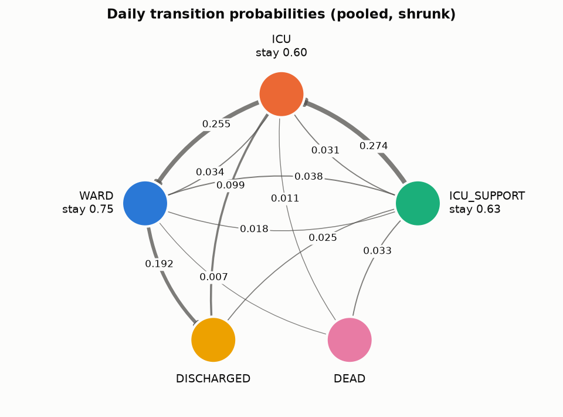
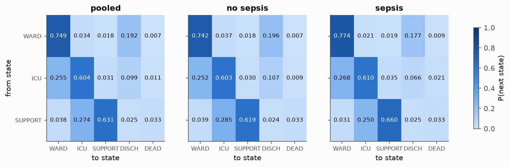
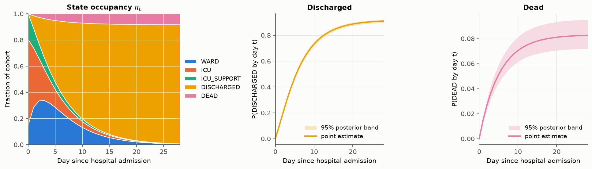
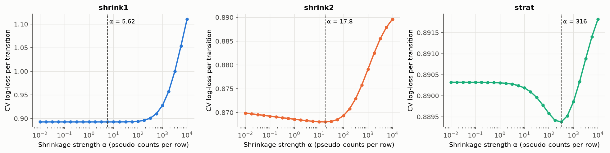
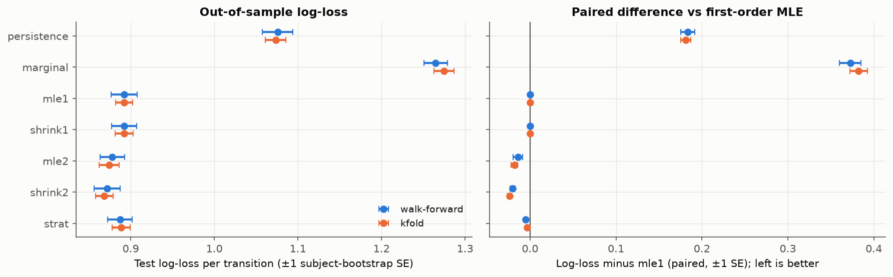
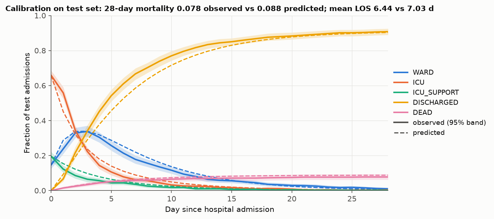
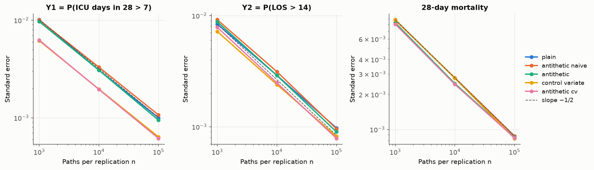
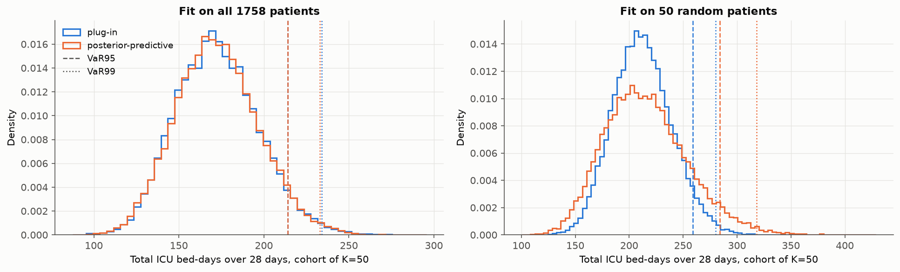

<!-- Generated from README.template.md by scripts/render_readme.py. Edit the template, not README.md. -->
# Markov models of ICU patient trajectories

Hospital stays from the open-access **eICU Collaborative Research Database demo**
({{n_admissions}} hospital stays, {{n_subjects}} patients, {{n_hospitals}} US hospitals,
{{n_transitions}} daily transitions) modelled as a discrete-time absorbing Markov chain over
`WARD → ICU → ICU_SUPPORT → {DISCHARGED, DEAD}`, with closed-form absorbing-chain results,
subject-level uncertainty, honest out-of-sample validation, and Monte Carlo with variance reduction.

**Headline numbers.** Model-implied in-hospital mortality is **{{mortality*100:.1f}}%**
(subject-bootstrap 95% CI {{mortality_ci_bootstrap.0*100:.1f}}–{{mortality_ci_bootstrap.1*100:.1f}}%;
observed {{observed_mortality*100:.1f}}%). Out of sample, the best model (`{{best_model.walk_forward}}`)
cuts log-loss by **{{logloss_gain_vs_persistence.walk_forward*100:.1f}}%** vs a persistence baseline
when trained on 2014 and tested on 2015. A control variate (ICU days, whose mean is known in
closed form) cuts Monte Carlo variance for P(ICU days > 7) by **{{vrf.y1/control_variate:.1f}}×**
(95% CI {{vrf_ci.y1/control_variate.0:.1f}}–{{vrf_ci.y1/control_variate.1:.1f}}), and common random numbers
cut the variance of sepsis-vs-no-sepsis contrasts by **{{crn_vrf.y1:.1f}}–{{crn_vrf.icu_days:.1f}}×**.
Ignoring parameter uncertainty understates cohort ICU-bed VaR99 by
**{{tail_VaR99_excess_vs_n.50*100:.0f}}%** when fitting on 50 patients, but makes no material difference
on the full sample.

## Method

**States and discretization.** Each hospital stay is cut into 24h blocks from hospital
admission. A day is `ICU` if ICU stays cover ≥ 60 minutes of it, and `ICU_SUPPORT` if it is an ICU day
with invasive ventilation or a vasopressor (norepinephrine, epinephrine, phenylephrine,
vasopressin, dopamine). The stay ends in `DEAD` (in-hospital death) or `DISCHARGED`.
Stays are truncated at 60 days. Organ support in eICU is charted as point events; events closer than
24h within an ICU stay are merged into one support interval. See `DECISIONS.md` for every choice.

**Estimation.** First-order MLE `P̂[i,j] = C[i,j] / C[i,·]` over transitions from transient states;
a second-order variant conditions on the previous day's state as well; Dirichlet shrinkage
`P̃ = (C + α m) / (C·1 + α)` with `α` chosen by subject-level 5-fold CV log-loss
(`α` = {{alphas.shrink1:.3g}} pooled, {{alphas.shrink2:.3g}} second-order, {{alphas.strat:.3g}} stratified).
Stratified fits (age < / ≥ 65, sepsis within 24h of ICU admission) are shrunk toward the pooled `P̃`.

**Analytic results.** With `Q` the transient block and `R` the transient→absorbing block,
`N = (I − Q)⁻¹`, expected LOS `τ = N1`, `Var(LOS) = (2N − I)τ − τ∘τ`, absorption probabilities
`B = NR`, cohort mortality `π₀·B[:, DEAD]`, occupancy `π_t = π₀Pᵗ`. The stationary distribution of
`P` is not reported: with absorbing states it puts all mass on `DISCHARGED`/`DEAD` and says nothing
about the hospital stay.

**Simulation.** A vectorized inverse-CDF simulator (loop over days, never over patients; 10⁶
paths × 60 days in ~1.4 s) accepts external uniforms for antithetic and common-random-number
coupling, and a per-path matrix index for posterior-predictive simulation.

**Uncertainty and tests.** Subject-level bootstrap and a Dirichlet posterior for parameters;
G-test plus subject-permutation test for stability across years and regions; likelihood-ratio,
AIC/BIC and parametric-bootstrap test of first- vs second-order. All splitting and resampling is
by patient, never by stay or day.

## Results



**1. Transitions.** Staying put dominates (ward {{P_shrunk.0.0:.2f}}, ICU {{P_shrunk.1.1:.2f}},
support {{P_shrunk.2.2:.2f}} per day); most ICU exits step down to the ward ({{P_shrunk.1.0:.3f}}/day)
rather than leaving hospital directly ({{P_shrunk.1.3:.3f}}/day).



**2. Sepsis.** Septic patients leave the ICU straight to discharge less often
({{P_strata.sepsis=1.1.3:.3f}} vs {{P_strata.sepsis=0.1.3:.3f}} per day) and die from the ICU more often
({{P_strata.sepsis=1.1.4:.3f}} vs {{P_strata.sepsis=0.1.4:.3f}}), even after shrinkage toward the pooled matrix.



**3. Occupancy.** Expected ICU days within 28 days is {{expected_icu_days:.2f}} per admission and
expected LOS is {{cohort_los:.2f}} days; posterior bands are tight for discharge and wider for death,
the rarer outcome.



**4. Shrinkage.** With ~14k transitions the pooled first-order fit needs almost no shrinkage, but
second-order and stratified rows are sparse and the CV optimum is interior.



**5. Model comparison.** Every Markov model beats persistence and the marginal baseline by a
wide margin; second-order with shrinkage is best. Its paired log-loss difference from first-order
MLE is {{best_vs_mle1.walk_forward.0:.4f}} ± {{best_vs_mle1.walk_forward.1:.4f}} walk-forward and
{{best_vs_mle1.kfold.0:.4f}} ± {{best_vs_mle1.kfold.1:.4f}} 5-fold (negative is better; ±1 subject-bootstrap SE).

{{table:model_comparison}}



**6. Calibration (train 2014 → test 2015).** Predicted 28-day mortality
{{calibration.mort28_predicted*100:.1f}}% vs observed {{calibration.mort28_observed*100:.1f}}%
(95% CI {{calibration.mort28_observed_ci.0*100:.1f}}–{{calibration.mort28_observed_ci.1*100:.1f}}%);
mean LOS {{calibration.los_predicted:.2f}} vs {{calibration.los_observed:.2f}} days. The first-order chain
discharges patients too slowly in the first week: a memoryless daily hazard cannot reproduce the early
peak of short stays, the same misfit the order test detects.



**7. Variance reduction.** All estimators follow the n^(−1/2) slope. At n = 10⁵ (500 replications;
95% bootstrap CIs) the variance reduction factors for P(ICU days > 7) are
{{vrf.y1/antithetic_naive:.2f}}× ({{vrf_ci.y1/antithetic_naive.0:.2f}}–{{vrf_ci.y1/antithetic_naive.1:.2f}}) naive antithetic,
{{vrf.y1/antithetic:.2f}}× ({{vrf_ci.y1/antithetic.0:.2f}}–{{vrf_ci.y1/antithetic.1:.2f}}) severity-ordered antithetic,
{{vrf.y1/control_variate:.2f}}× ({{vrf_ci.y1/control_variate.0:.2f}}–{{vrf_ci.y1/control_variate.1:.2f}}) control variate and
{{vrf.y1/antithetic_cv:.2f}}× ({{vrf_ci.y1/antithetic_cv.0:.2f}}–{{vrf_ci.y1/antithetic_cv.1:.2f}}) both. The control variate does
the work; antithetic pairing adds little on this chain. For targets with an exact value (P(LOS > 14),
28-day mortality) every estimator's mean is within 3 SE of it (largest |z| = {{vr_max_abs_z:.2f}}).
Common random numbers cut the variance of the sepsis-vs-no-sepsis difference by {{crn_vrf.y1:.1f}}× for
P(ICU days > 7) and {{crn_vrf.mort:.1f}}× for 28-day mortality.



**8. Tail risk.** For a cohort of 50 admissions, plug-in VaR99 of ICU bed-days over 28 days is
{{tail.plug_in.VaR99:.0f}} vs {{tail.posterior_predictive.VaR99:.0f}} posterior-predictive: on the full
sample, patient-level randomness swamps parameter uncertainty (left panel). Fitting on 50 random
patients (right panel) the posterior-predictive tail is visibly heavier. Refitting on 50 / 100 / 250 / 500 patients it grows to
{{tail_VaR99_ratio_vs_n.500:.3f}} / {{tail_VaR99_ratio_vs_n.250:.3f}} / {{tail_VaR99_ratio_vs_n.100:.3f}} /
{{tail_VaR99_ratio_vs_n.50:.3f}}× (posterior / plug-in), so the cost of ignoring parameter uncertainty is a
small-sample problem.

**Stability and order.** Transition probabilities are stable across years (G = {{stability.era.G:.1f}},
df = {{stability.era.df}}, permutation p = {{stability.era.p_perm:.2f}}) but differ across US regions
(G = {{stability.region.G:.1f}}, df = {{stability.region.df}}, permutation p = {{stability.region.p_perm:.4f}}).
First-order is rejected against second-order (LR = {{order_test.LR:.0f}} on {{order_test.df:.0f}} df,
parametric-bootstrap p = {{order_test.p_boot:.4f}}, the smallest attainable; BIC {{order_test.bic1:.0f}} vs
{{order_test.bic2:.0f}}). The bootstrap intervals are up to {{max_boot_over_post_width:.2f}}× wider than
the Dirichlet ones because days from the same patient are correlated.

## What didn't work / limitations

- **Markov assumption.** First-order is rejected and the calibration plot shows why: no duration
  dependence. Second-order helps out of sample, but part of the apparent memory is probably
  unobserved heterogeneity between patients (a mixture of first-order chains looks higher-order).
  A semi-Markov or covariate-rich model is the natural next step.
- **Antithetic variates barely help** ({{vrf.y1/antithetic_naive:.2f}}× naive, {{vrf.y1/antithetic:.2f}}×
  severity-ordered). With states laid out in index order on [0, 1), a high uniform means both
  discharge and death, so outcomes are not monotone in the uniforms; ordering the inverse CDF by
  severity restores negative pair correlation for one step, but over 28 steps of a strongly
  persistent chain the coupling washes out. No order makes LOS monotone, since both absorbing
  states end the stay.
- **P(LOS > 14) is not simulation-only**, as the spec assumed: it equals the transient mass of
  `π₁₄`. It serves as a second unbiasedness check.
- **ICU patients only.** eICU records start from an ICU admission, so ward-only stays are missing and
  `WARD` days are those before, between or after ICU stays.
- **Daily discretization.** Sub-day moves are lost, and a day with any ICU hour above the threshold
  counts as an ICU day.
- **Organ support from point events.** Ventilation and vasopressors are charted, not timed as
  intervals; the 24h gap-filling rule is a modelling choice.
- **Sepsis look-ahead, mostly avoided.** Sepsis counts only if documented within 24h of first ICU
  admission. Using diagnoses from any time in the stay would condition on the future (discharge
  coding), which is fine for description but look-ahead bias in a real-time predictor.
- **In-hospital death only.** Death after discharge is invisible; `DISCHARGED` includes transfers
  to other hospitals and hospice.
- **Small demo sample and short era span.** Two discharge years (2014, 2015) and a demo subset
  of a much larger database; region and hospital differences cannot be separated from case mix here.

Future work: continuous-time multi-state models, SOFA-based states, more covariates, readmissions,
post-discharge mortality.

## Reproduce

```bash
uv sync                                    # Python 3.12, numpy/pandas/scipy/matplotlib/pyyaml/pyarrow
# download the eICU-CRD demo tables (open access, no credentialing)
B=https://physionet.org/files/eicu-crd-demo/2.0.1; D=data/raw/eicu-crd-demo; mkdir -p $D
for f in patient hospital diagnosis treatment infusiondrug respiratoryCharting; do
  curl -sfo $D/$f.csv.gz $B/$f.csv.gz; done
uv run python scripts/build_states.py      # raw tables -> data/processed/*.parquet
uv run python scripts/run_all.py           # -> results/ (add --quick for a ~10 s run)
uv run python scripts/run_all.py --synthetic   # same pipeline on synthetic data, no download needed
uv run python scripts/render_readme.py     # fill this README from results/metrics.json
uv run pytest                              # fast tests; `-m slow` for size/power checks
uv run python scripts/benchmark_sim.py     # 10^6 x 60-step simulation timing
```

The loader reads `data.root` from `config.yaml`; the full eICU-CRD (credentialed) uses the same schema,
so switching is a change to that path.
